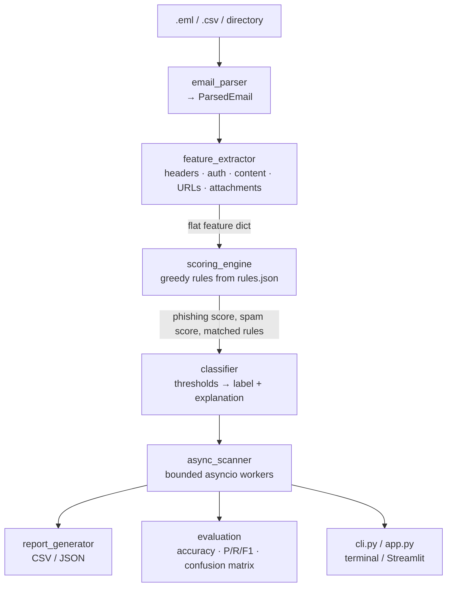

# Email Spam & Phishing Classifier — Project Report

> An explainable, rule-based pipeline that classifies emails as **Spam**, **Phishing** or **Legitimate**, with a CLI, an asynchronous batch scanner, CSV/JSON reporting, an evaluation module and a local Streamlit dashboard.

| | |
|---|---|
| **Project type** | Cybersecurity / Email security / Applied software engineering |
| **Language** | Python 3.11+ (developed and tested on 3.12) |
| **Core dependencies** | Python standard library only (Streamlit + pandas only for the dashboard) |
| **Interfaces** | Command line (`cli.py`), Streamlit dashboard (`app.py`) |
| **Test suite** | 129 automated tests, all passing |
| **Status** | Complete, academic / portfolio project |

---

## Table of Contents

1. [Abstract](#1-abstract)
2. [Introduction and Problem Statement](#2-introduction-and-problem-statement)
3. [Objectives](#3-objectives)
4. [System Architecture](#4-system-architecture)
5. [Module Description](#5-module-description)
6. [Feature Extraction](#6-feature-extraction)
7. [Greedy Scoring Engine](#7-greedy-scoring-engine)
8. [Asynchronous Batch Scanner](#8-asynchronous-batch-scanner)
9. [User Interfaces](#9-user-interfaces)
10. [Dataset](#10-dataset)
11. [Evaluation and Results](#11-evaluation-and-results)
12. [Performance Benchmark](#12-performance-benchmark)
13. [Testing and Quality Assurance](#13-testing-and-quality-assurance)
14. [Security and Privacy Design](#14-security-and-privacy-design)
15. [Limitations](#15-limitations)
16. [Future Work](#16-future-work)
17. [Conclusion](#17-conclusion)
18. [Reproducing the Results](#18-reproducing-the-results)

---

## 1. Abstract

Spam and phishing emails remain among the most common ways attackers deliver scams, credential-harvesting pages and malware. This project implements an **explainable, rule-based email classifier** that inspects the headers, body text, links and attachment names of a message and assigns it one of three labels: `legitimate`, `spam` or `phishing`.

Rather than a black-box model, the system uses **38 configurable rules** with weights, thresholds and keyword lexicons stored in a single JSON file. A **greedy scoring engine** evaluates the most influential rules first and stops early once the verdict is decisive. Every decision comes with a human-readable explanation listing each rule that fired, the points it contributed and the evidence found.

On the bundled 51-email labelled synthetic dataset the classifier reaches **94.12 % accuracy (48/51)** with a macro F1 of **0.943**. These figures are optimistic by design (see [Section 11.3](#113-how-to-interpret-these-numbers)); the project is intended as a transparent, extensible foundation rather than a production filter.

## 2. Introduction and Problem Statement

Email is a primary attack surface. Unwanted and malicious messages fall broadly into two groups:

- **Spam** — unsolicited bulk mail: lotteries, pharmacy offers, get-rich-quick schemes, aggressive marketing.
- **Phishing** — messages that impersonate a trusted party to steal credentials or money, or to deliver malware (look-alike domains, fake login links, malicious attachments, business-email-compromise).

Many modern filters rely on opaque machine-learning models. For learning, auditing and incident-response contexts, it is valuable to have a classifier whose decisions can be **read, questioned and tuned**. This project addresses the question:

> *Can a transparent, configurable rule engine reliably separate spam, phishing and legitimate email, and clearly explain why?*

## 3. Objectives

1. Parse real-world email formats (`.eml` files and CSV datasets).
2. Extract meaningful header, authentication, content, URL and attachment features.
3. Score emails with a configurable rule engine using a **greedy** evaluation strategy.
4. Produce a clear, evidence-based explanation for every classification.
5. Scan large batches efficiently with bounded `asyncio` concurrency.
6. Generate CSV/JSON reports and standard evaluation metrics (accuracy, precision, recall, F1, confusion matrix).
7. Provide both a CLI and a local dashboard.
8. Guarantee **safe handling**: no network access, no link following, no attachment execution.

## 4. System Architecture

The system is a linear pipeline in which each stage has a single responsibility.



### Project layout

```
email-spam-phishing-classifier/
├── app.py                    Streamlit dashboard
├── cli.py                    CLI: classify | scan | evaluate | benchmark
├── requirements.txt
├── config/rules.json         Rules, weights, thresholds, lexicons, brand list
├── src/
│   ├── email_parser.py       .eml / CSV / directory parsing
│   ├── feature_extractor.py  Header, auth, content, URL, attachment features
│   ├── scoring_engine.py     Greedy rule-based scoring
│   ├── classifier.py         Label + explanation
│   ├── async_scanner.py      Bounded asyncio batch scanning + benchmark
│   ├── report_generator.py   CSV / JSON reports
│   ├── evaluation.py         Accuracy, P/R/F1, confusion matrix
│   ├── config.py, models.py  Config validation, shared dataclasses
├── data/                     51 labelled CSV emails + 6 .eml samples
├── scripts/generate_sample_data.py
├── tests/                    129 unit + integration tests
├── docs/                     Architecture, scoring rules, evaluation, demo guide
└── reports/                  Generated reports (git-ignored)
```

The project is roughly **3,300 lines of Python** (about 1,950 in `src/`, `cli.py` and `app.py`; the rest in tests).

## 5. Module Description

| Module | Responsibility |
|---|---|
| `models.py` | Dataclasses: `ParsedEmail`, `Attachment`, `RuleMatch`, `ClassificationResult` |
| `config.py` | Loads and validates `config/rules.json`; raises `ConfigError` with a clear message on any problem |
| `email_parser.py` | Parses `.eml` (stdlib `email`), CSV (with column aliases) and directories; collects per-row errors instead of crashing |
| `feature_extractor.py` | Sender/Reply-To/Return-Path/Message-ID checks, SPF/DKIM/DMARC, keyword families, URL/HTML analysis, attachment-name analysis |
| `scoring_engine.py` | Greedy rule evaluation with early exit |
| `classifier.py` | `EmailClassifier`: features → scores → label → explanation. `classify_safe` never raises |
| `async_scanner.py` | `AsyncScanner` (worker pool + `asyncio.to_thread`) and `benchmark()` |
| `report_generator.py` | CSV/JSON reports with CSV formula-injection protection |
| `evaluation.py` | Metrics implemented from scratch (no scikit-learn) |

## 6. Feature Extraction

For each email the extractor produces a flat dictionary of features, grouped as follows.

| Group | Examples of signals |
|---|---|
| **Sender / headers** | From vs Reply-To / Return-Path / Message-ID domain mismatch; look-alike brand domains (e.g. digit/letter swaps like `paypa1`); brand name in display name with wrong domain; executive title sent from a free-mail account |
| **Authentication** | SPF, DKIM and DMARC results (pass / fail / softfail / permerror), parsed from `Authentication-Results` and `Received-SPF` |
| **Content (lexicons)** | Spam keywords (53), urgency phrases (23), credential requests (37), account threats (23), financial lures (23) |
| **Style** | Exclamation marks, uppercase ratio (body and subject), currency amounts, unsubscribe text, empty subject |
| **URLs** | Raw-IP hosts, `@` userinfo trick, punycode/IDN, URL shorteners, abused TLDs, brand-in-host mismatch, excessive subdomains/hyphens, link-text vs target mismatch |
| **HTML** | Embedded password forms |
| **Attachments** | Executable/script extensions, double extensions (`invoice.pdf.exe`), HTML attachments, macro-enabled Office files, archives — judged **by file name only** |

All lexicons, the 18-brand reference list, and the shortener/TLD/extension lists live in `config/rules.json`.

## 7. Greedy Scoring Engine

### 7.1 Rule set

There are **38 rules**:

| Category | Rule IDs | Count | Purpose |
|---|---|---|---|
| Phishing | `PH01`–`PH23` | 23 | Impersonation, credential theft, malicious links/attachments, BEC |
| Spam | `SP01`–`SP10` | 10 | Bulk-mail vocabulary, lures, formatting, link volume |
| Both | `BO01`–`BO04` | 4 | Urgency, shorteners, abused TLDs (add to both scores) |
| Mitigating | `LG01` | 1 | −15 points when ≥ 2 of SPF/DKIM/DMARC pass |

Each rule defines a `weight`, a `category`, a feature condition (`true`, `gte`, `eq`, `in`) and optional `per_hit` scaling, where the contribution is `min(weight, per_hit × value)`, so `weight` acts as a cap.

### 7.2 Greedy strategy

1. Sort all rules once by **absolute weight, descending** (ties broken by rule ID), so the strongest evidence is examined first.
2. Evaluate rules in that order, adding each matching rule's points to the phishing score, spam score, or both.
3. **Early exit:** once either score reaches the *decisive score* (default **90**), stop. The remaining smaller rules can no longer realistically reverse the verdict.
4. Clamp scores to 0–100.

The result records `early_exit` and `rules_evaluated`, so the shortcut is always transparent. The known trade-off is that mitigating (negative) rules evaluated late are skipped after an early exit.

### 7.3 Decision logic

| Condition | Outcome |
|---|---|
| Phishing score ≥ **50** and/or spam score ≥ **40** | Candidate label(s) |
| Both are candidates | Higher score wins; an exact tie goes to **phishing** (the safer, more severe label) |
| Neither is a candidate | **Legitimate** |

`risk_score = max(phishing_score, spam_score)`.

### 7.4 Example explanation output

```
Classified as PHISHING (risk score 100.0/100; phishing=100.0, spam=0.0; thresholds: phishing>=50, spam>=40).
  - [PH01] Look-alike brand domain in sender: +35 to phishing (lookalike_brand_domain=PayPal)
  - [PH02] Brand name in display name, wrong sender domain: +30 to phishing
  - [PH06] Credential / sensitive-data request phrases: +24 to phishing
    (credential_count=2 [verify your account, confirm your password])
```

## 8. Asynchronous Batch Scanner

A fixed pool of `concurrency` worker coroutines drains an `asyncio.Queue` of email indices; each classification runs through `asyncio.to_thread`. Results are stored **by index**, so output order always equals input order.

Guarantees provided by the design:

- **Bounded concurrency** — never more than `concurrency` classifications in flight.
- **Ordered results** — deterministic output regardless of completion order.
- **Error isolation** — one malformed email yields an `error` result and never aborts the batch.
- **Responsiveness** — the event loop stays free (useful for the dashboard).

## 9. User Interfaces

### 9.1 Command-line interface (`cli.py`)

| Command | Purpose |
|---|---|
| `classify <path>` | Explain one or more emails (`.eml`, CSV or directory); `--json`, `--limit` supported |
| `scan <path>` | Async batch scan with CSV/JSON reports written to `reports/` |
| `evaluate <path>` | Accuracy, per-class P/R/F1, confusion matrix; `--show-errors` lists misclassifications |
| `benchmark <path>` | Sequential vs asyncio throughput at several concurrency levels |

Exit codes: `0` success · `2` input/config error · `130` interrupted.

### 9.2 Streamlit dashboard (`app.py`)

Run with `streamlit run app.py`. Three tabs:

- **Single email** — upload an `.eml` or paste fields; view scores, matched rules and the explanation.
- **Batch scan** — upload CSV/`.eml` files, run the async scan, filter and inspect results, view metrics and confusion matrix, download CSV/JSON.
- **Rules & config** — table of all active rules; thresholds and concurrency adjustable from the sidebar.

## 10. Dataset

All data is **synthetic**. Company and URL domains are invented, and IP addresses use the reserved `192.0.2.0/24` documentation range, so nothing points to real infrastructure.

| Dataset | Size | Composition |
|---|---|---|
| `data/sample_emails.csv` | 51 emails | 20 legitimate · 15 spam · 16 phishing (includes deliberate edge cases) |
| `data/eml_samples/` | 6 `.eml` files | 2 legitimate · 2 spam · 2 phishing (label inferred from file-name prefix) |

Supported CSV columns: `subject` and/or `body` (required), plus optional `id`, `label`, `sender`, `reply_to`, `return_path`, `message_id`, `spf`, `dkim`, `dmarc`, `attachments`.

## 11. Evaluation and Results

### 11.1 Results on `sample_emails.csv` (51 emails)

**Overall accuracy: 0.9412 (48 / 51)**

| Class | Precision | Recall | F1-score | Support |
|---|---:|---:|---:|---:|
| legitimate | 0.8696 | 1.0000 | 0.9302 | 20 |
| spam | 1.0000 | 0.9333 | 0.9655 | 15 |
| phishing | 1.0000 | 0.8750 | 0.9333 | 16 |
| **macro avg** | **0.9565** | **0.9361** | **0.9430** | 51 |
| weighted avg | 0.9488 | 0.9412 | 0.9416 | 51 |

**Confusion matrix** (rows = true label, columns = predicted label):

| | legitimate | spam | phishing |
|---|---:|---:|---:|
| **legitimate** | 20 | 0 | 0 |
| **spam** | 1 | 14 | 0 |
| **phishing** | 2 | 0 | 14 |

No legitimate email was flagged (zero false positives), and no spam/phishing confusion occurred; all three errors are *missed detections* classified as legitimate.

### 11.2 Error analysis

| Email | True | Predicted | Why it was missed |
|---|---|---|---|
| `spam-07` | spam | legitimate | Advance-fee scam from a Yahoo address that passes authentication; the mitigating rule `LG01` cancels the lure score |
| `edge-03` | phishing | legitimate | CEO gift-card fraud: no links, no brand, only soft signals (`PH23`, `SP02`, `BO01`) |
| `edge-08` | phishing | legitimate | Very short smishing-style message with a single shortened link |

These cases were intentionally left unfixed to document honest weaknesses. They illustrate the core trade-off of rule-based systems: well-written, link-free social engineering produces too little evidence to cross the thresholds.

### 11.3 How to interpret these numbers

The results are **optimistic** and should not be read as real-world accuracy:

- The dataset is small (51 messages) and template-based.
- The rules and the data were authored together, so the rules fit the data.
- There is no held-out test set, no cross-validation, and thresholds were chosen by hand.
- Class balance is artificial; real mail is overwhelmingly legitimate, so real-world precision for spam/phishing would be lower.
- SPF/DKIM/DMARC values in the CSV are typed in, not produced by a real receiving server.

### 11.4 Results on the `.eml` samples

| File | True | Predicted | Risk score |
|---|---|---|---:|
| `legitimate_meeting.eml` | legitimate | legitimate | 0.0 |
| `legitimate_newsletter.eml` | legitimate | legitimate | 0.0 |
| `phishing_invoice_exe.eml` | phishing | phishing | 90.0 |
| `phishing_paypal_lookalike.eml` | phishing | phishing | 100.0 |
| `spam_lottery.eml` | spam | spam | 90.0 |
| `spam_pharmacy_html.eml` | spam | spam | 58.0 |

All 6 classified correctly (100 %), again a very small sample.

## 12. Performance Benchmark

Measured on the development machine with 1,020 emails (51 emails × 20 copies):

| Mode | Concurrency | Seconds | Emails/s | vs. sequential |
|---|---:|---:|---:|---:|
| Sequential loop | 1 | 0.397 | 2,568 | 1.00× |
| asyncio scanner | 1 | 0.458 | 2,226 | 0.87× |
| asyncio scanner | 4 | 0.450 | 2,266 | 0.88× |
| asyncio scanner | 8 | 0.453 | 2,253 | 0.88× |

**Finding:** classification is CPU-bound pure Python, so the GIL prevents a real speed-up from `asyncio` + threads. The async design is valuable for **bounded concurrency, ordered output, error isolation and UI responsiveness**, not raw throughput. For true parallelism, a process pool would be the natural next step. Absolute numbers vary by machine; reproduce them with `python cli.py benchmark`.

## 13. Testing and Quality Assurance

**129 automated tests** — all passing (`Ran 129 tests … OK`).

| Test module | Tests | Focus |
|---|---:|---|
| `test_feature_extractor.py` | 25 | Header, URL, content and attachment features |
| `test_email_parser.py` | 23 | `.eml`, CSV, aliases, bad-row handling |
| `test_integration.py` | 21 | End-to-end runs, CLI commands, no-network guard |
| `test_scoring_engine.py` | 18 | Greedy order, early exit, per-hit caps, config validation |
| `test_classifier.py` | 14 | Thresholds, tie-breaking, explanations |
| `test_async_scanner.py` | 13 | Ordering, bounded concurrency, error isolation |
| `test_evaluation.py` | 8 | Metrics against a hand-computed example |
| `test_report_generator.py` | 7 | CSV/JSON output, formula-injection protection |

The Streamlit UI itself is not covered by automated tests; the suite only verifies that `app.py`'s `src` imports are valid.

## 14. Security and Privacy Design

- **Fully local** — no email content leaves the machine; no paid APIs.
- **No network code** — URLs are parsed with `urllib.parse` only; no DNS lookups, no fetching. A test guards against accidental network use.
- **Attachments never opened** — judged by file name, MIME type and size only.
- **Safe HTML handling** — HTML is parsed, never rendered; the dashboard shows bodies as plain text and URLs as inert text.
- **CSV formula-injection protection** — report cells beginning with `=`, `+`, `-` or `@` are prefixed with `'`.
- **Resource limits** — body size capped by `limits.max_body_chars`; `.eml` files over 25 MB are rejected.

## 15. Limitations

- **Rule-based, no learning** — novel wording and well-crafted targeted phishing can evade detection.
- **English-only lexicons.**
- **Authenticated mail can still be malicious** (compromised accounts, attacker-owned domains with valid SPF/DKIM); mitigating rule `LG01` can mask this.
- **List-based brand matching** — e.g. `apple-id-verify.com` is caught but `appleid-verify.com` would be missed.
- **Approximate registered-domain logic** — uses a small built-in suffix list rather than the full Public Suffix List.
- **No content inspection** of attachments or images; QR-code phishing, image-only mail and HTML smuggling are not detected.
- **Legitimate marketing mail** can resemble spam.
- **Synthetic, tiny dataset** — see [Section 11.3](#113-how-to-interpret-these-numbers).
- **Dashboard** was smoke-tested with a stubbed `streamlit` module and not in a real browser (Streamlit ≥ 1.30 required).

## 16. Future Work

1. Evaluate on public labelled corpora (SpamAssassin Public Corpus, Enron-Spam, Nazario phishing corpus) with a proper tune/test split.
2. Learn rule weights from data (e.g. logistic regression) while keeping explanations.
3. Hybrid approach: use the rule engine's matches as features for a lightweight ML model.
4. Multi-language lexicons and improved Unicode homoglyph detection.
5. Full Public Suffix List support and a larger, updatable brand database.
6. Attachment content analysis (sandboxed) and QR-code detection.
7. `ProcessPoolExecutor` for genuine multi-core throughput.
8. Mailbox integration (IMAP) and a REST API.
9. Automated UI tests and CI (GitHub Actions) running the test suite.

## 17. Conclusion

This project delivers a complete, well-tested and **explainable** email classification pipeline. Its configurable greedy rule engine reaches 94.12 % accuracy on the bundled synthetic data with zero false positives, and every verdict is traceable to specific rules and evidence. The project honestly documents its weaknesses — a small synthetic dataset, English-only lexicons, and blind spots around link-free social engineering — and a safety-first design that never touches the network or executes content. It is a solid foundation for further research, such as evaluating on real corpora and hybridising with machine learning.

## 18. Reproducing the Results

```bash
# 1. Set up
git clone https://github.com/GALIJITHENDRASAICHANDRABARADVAJ/2601240016_MTech_Computational_Thinking_and_Programming.git
cd email-spam-phishing-classifier
python3 -m venv .venv && source .venv/bin/activate      # Windows: .venv\Scripts\activate
pip install -r requirements.txt

# 2. Run the tests (129 tests)
python -m unittest discover -s tests -v

# 3. Evaluate
python cli.py evaluate data/sample_emails.csv --show-errors

# 4. Classify and explain a single email
python cli.py classify data/eml_samples/phishing_paypal_lookalike.eml

# 5. Batch scan and write reports
python cli.py scan data/sample_emails.csv

# 6. Benchmark
python cli.py benchmark data/sample_emails.csv --copies 20 --concurrency 1,4,8,16

# 7. Dashboard
streamlit run app.py
```

> **Note:** All sample emails are synthetic. Do not visit any URL found in the sample data.

---

*Further documentation: [`docs/architecture.md`](docs/architecture.md) · [`docs/scoring_rules.md`](docs/scoring_rules.md) · [`docs/evaluation_and_limitations.md`](docs/evaluation_and_limitations.md) · [`docs/demo_guide.md`](docs/demo_guide.md)*
